# grawji features

A tour of what grawji does. Every render you see here
came directly out of a connected body via the same engine that develops the JPEGs in
the camera.

- [Develop through the camera](#develop-through-the-camera)
- [Compare, histogram and clipping](#compare-histogram-and-clipping)
- [Recipes](#recipes)
- [Custom banks on the camera](#custom-banks-on-the-camera)
- [Recipe from an edit](#recipe-from-an-edit)
- [Browse, rate and organize](#browse-rate-and-organize)
- [Crop, straighten and perspective](#crop-straighten-and-perspective)
- [Export](#export)
- [Keyboard](#keyboard)

## Develop through the camera

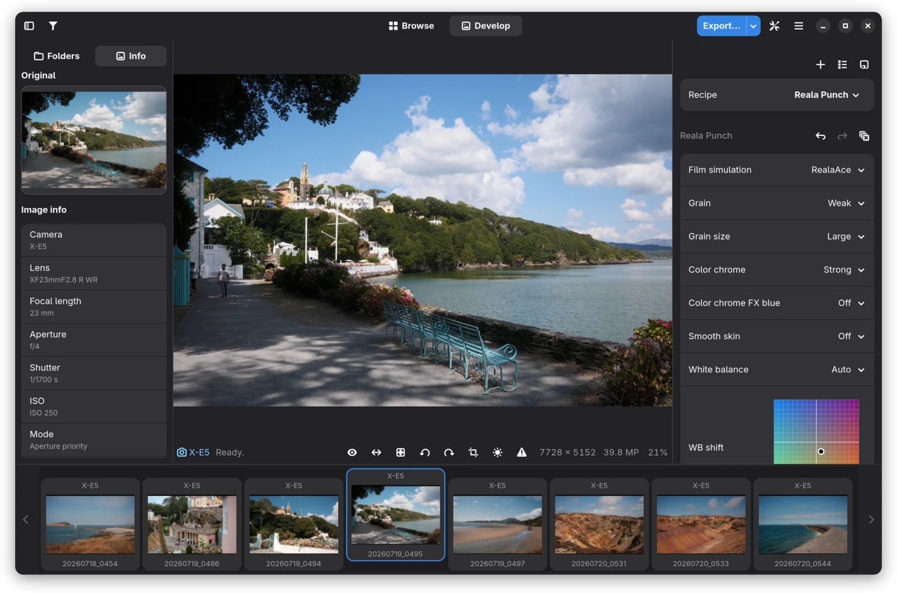

Pick a RAF and grawji sends it to the camera once. From then on every
change in the recipe panel is rendered by the camera's own conversion
engine, so film simulations, grain and color chrome look exactly like
they do in the camera. The first preview is the JPEG embedded in the
RAF, and renders follow as you move a control.

- **All recipe settings** in the camera's own menu order: film
  simulation, grain, color chrome and FX blue, smooth skin, white
  balance with a shift grid and free Kelvin, dynamic range, tones in
  half steps, color, sharpness, noise reduction, clarity and the two
  axes of monochrome toning. Only what the connected body supports is
  offered.
- **Exposure per image**, kept apart from the recipe, so one recipe
  fits a whole folder while each frame keeps its own brightness.
- **Hold to peek** at the in-camera original (`\` or hold the eye
  button).
- **Zoom** up to 800 % with pan, and a navigator on the Info tab's
  original thumbnail.
- **Image info**: camera, lens, exposure and the pixel size after
  cropping.
- **RAW+JPEG shots** can open from the camera JPEG instead, switch with
  `j`.
- Works without a camera too: you can browse and the in-camera JPEG is
  shown.

## Compare, histogram and clipping

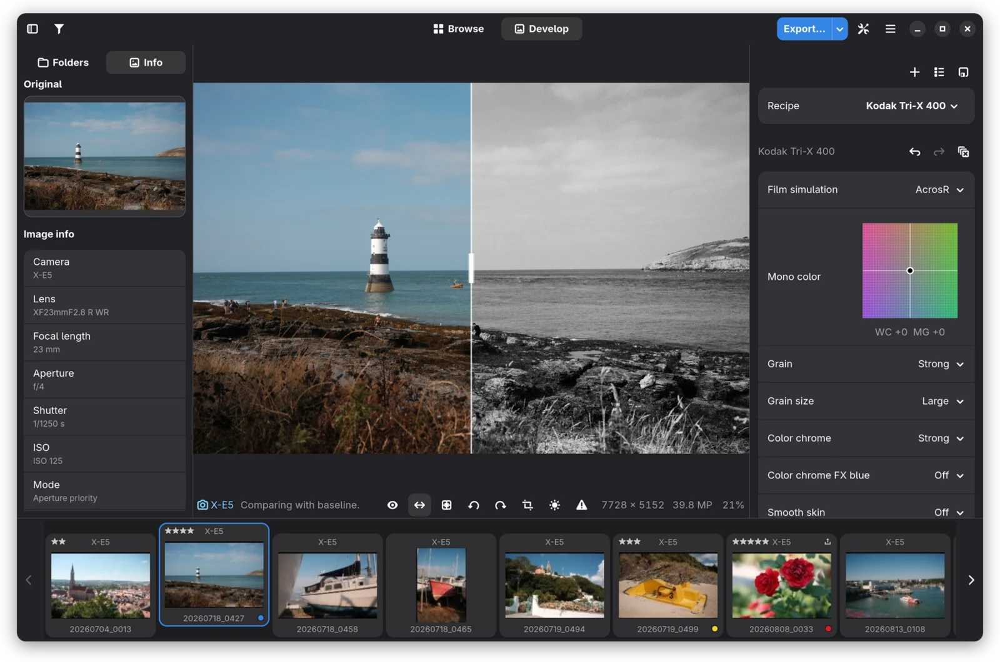

Star a recipe in the recipe manager and the split view compares any
other recipe against it, with a second real render behind a draggable
divider. Here a Tri-X black and white recipe against a Classic Chrome
baseline.

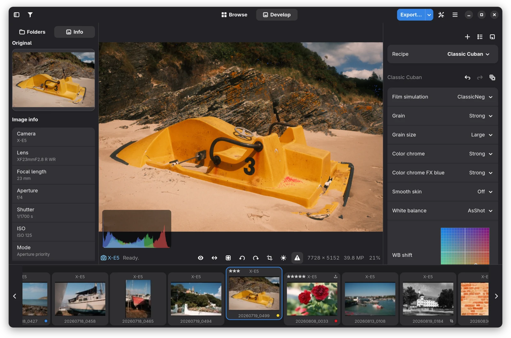

The histogram (`h`, click it to switch between RGB and luminance) and
the clipping overlay (clipped highlights red, crushed shadows blue) work
on the camera's render. `b` cycles the canvas background.

## Recipes

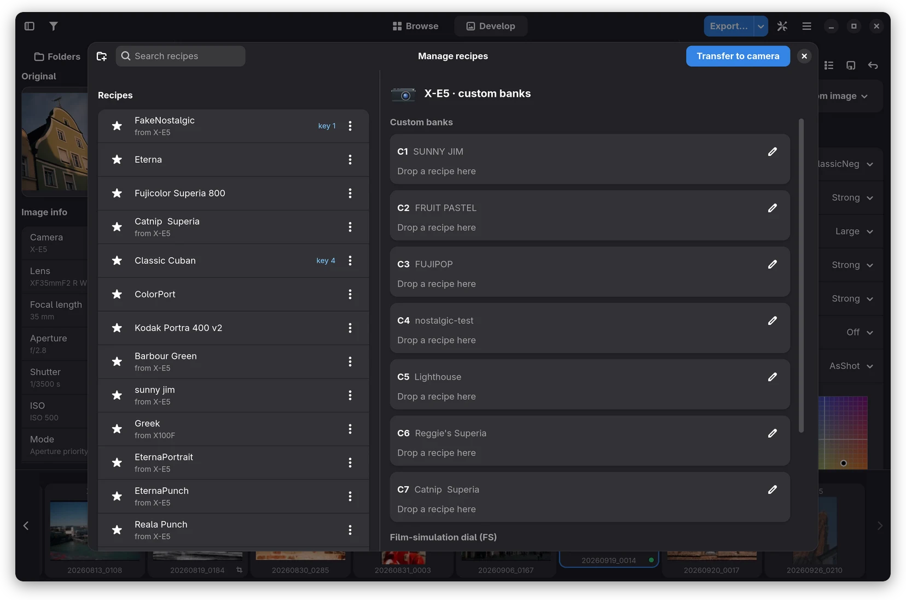

- **A recipe library** with folders, drag and drop ordering, search by
  name, comment or film simulation, comments, and a thumbnail rendered
  by the camera.
- **Hotkeys**: give a recipe a number key and press it in the main
  window to apply it.
- **Fit per body**: each recipe shows how well it fits the connected
  camera, and grawji says what a body drops (for example clarity) when
  you apply it. Duplicates are recognized by their look, not by name.
- **Import** from a photo (the recipe it was shot with), from an edited
  export (see below), from X RAW STUDIO files (FP1, FP2, FP3) and from
  community recipe text in the clipboard, English or German.
- **Share** as X RAW STUDIO files or as plain text (`Ctrl+Shift+C`).
- **Undo and redo** every edit with `Ctrl+Z` and `Ctrl+Shift+Z`: a
  slider drag is one step, applying a recipe is one step, and the
  history starts over with each image.

### Custom banks on the camera

Drag a recipe onto one of the camera's custom banks (C1 to C7, on some
bodies C1 to C4) to write it into the camera, or onto a film simulation
dial position on the X-E5. Banks can be renamed, and empty banks are
named after the recipe dropped on them. The camera's settings can also
be backed up to a file and restored.

This is experimental. It is verified on the X100F, X-T3 and X-E5.
Bodies sharing their write mechanism (X-Pro2, X-T2, X-T20, X-E3, X-T30
and the other X-Processor 5 models) should work but are untested. It is
not possible yet on the X-H1, the X-Processor 4 bodies from the X-Pro3
to the X-T30 II, and the GFX models before the GFX100 II. You can help
enable your body, see [enable-bank-writing.md](enable-bank-writing.md).

### Try Recipes

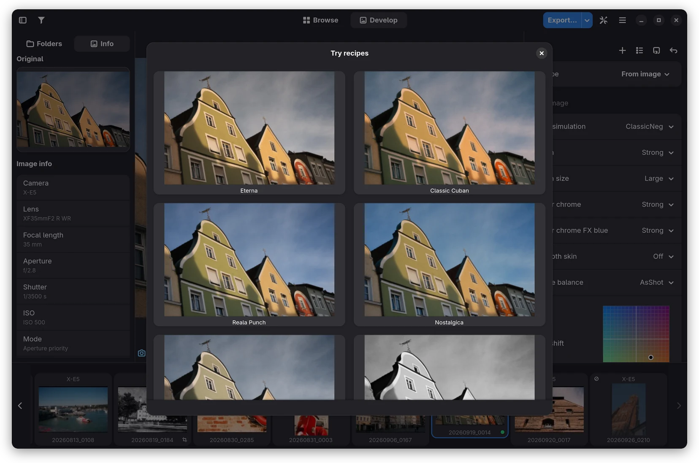

Try Recipes renders the open image with every recipe you tick, side by
side. Click one to apply it.

## Recipe from an edit

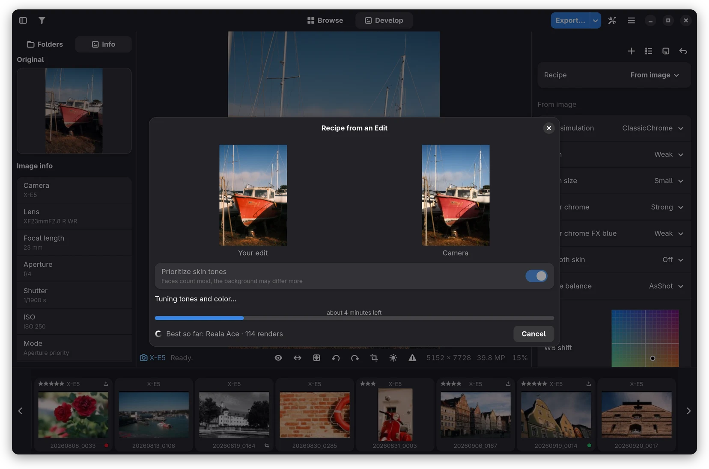

Edited a shot in darktable, Lightroom or anything else and want that
look straight out of the camera? Pick the edited export and grawji
searches, with the real camera engine, for the recipe that comes
closest to it. An export in AdobeRGB is read as such, so its colors
count as they are.

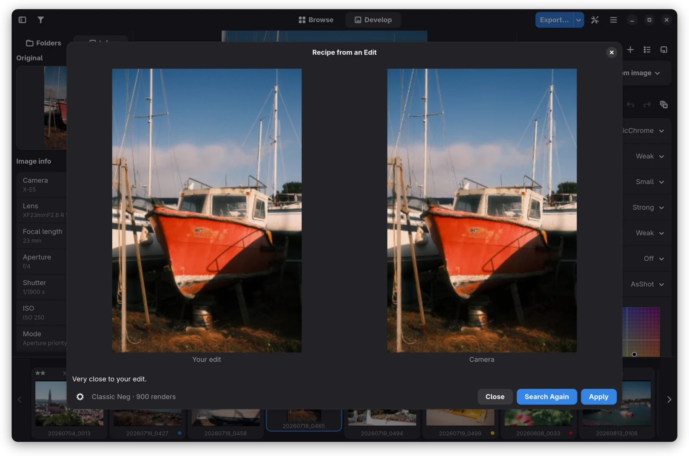

The look is judged at a small size, where sharpness, noise reduction
and grain are invisible, so those come back neutral. Switch on **Match
the texture as well** and the search ends with a pass on full-size
renders that settles them too. It takes a minute longer and only tells
something from a full-size export.

**Renders to spend** is how long the search may take. When they are
used up it settles for the best it has, and the time shown counts down
from the start instead of growing. The slider's top means no limit.

## Browse, rate and organize

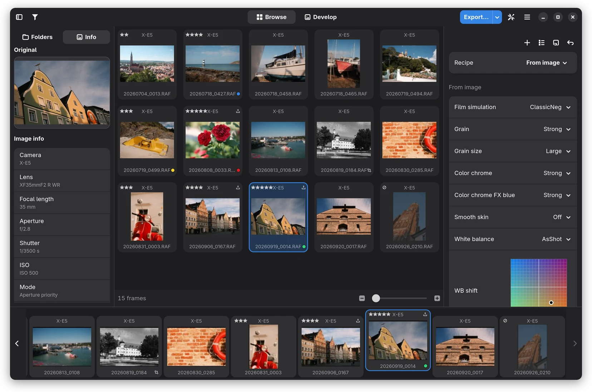

- **Folder tree** with bookmarks, and a filmstrip or a grid
  (`g` switches) whose thumbnails come from the RAFs themselves.
- **Marks**: one to five stars, five color labels, reject and a mark
  for export, from the keyboard or the floating marks bar (`m`).
- **Filter** by camera, lens, focal length, rating, label and marks.
- **File operations**: copy, move, trash (with undo for moves), open
  with another app, or drag cards onto a folder. Each RAF's edits
  travel with it.

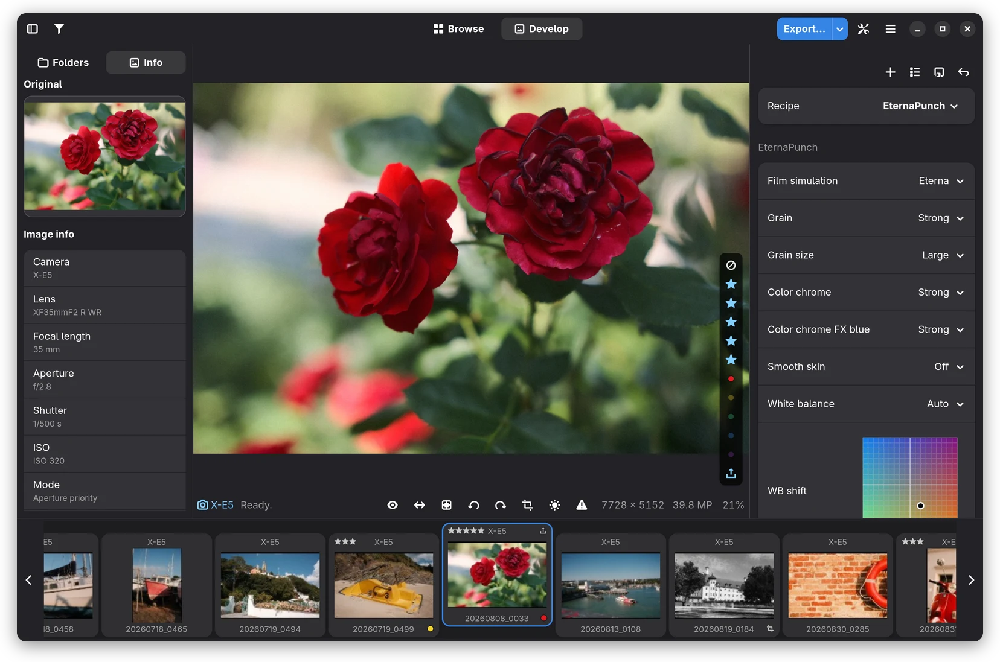

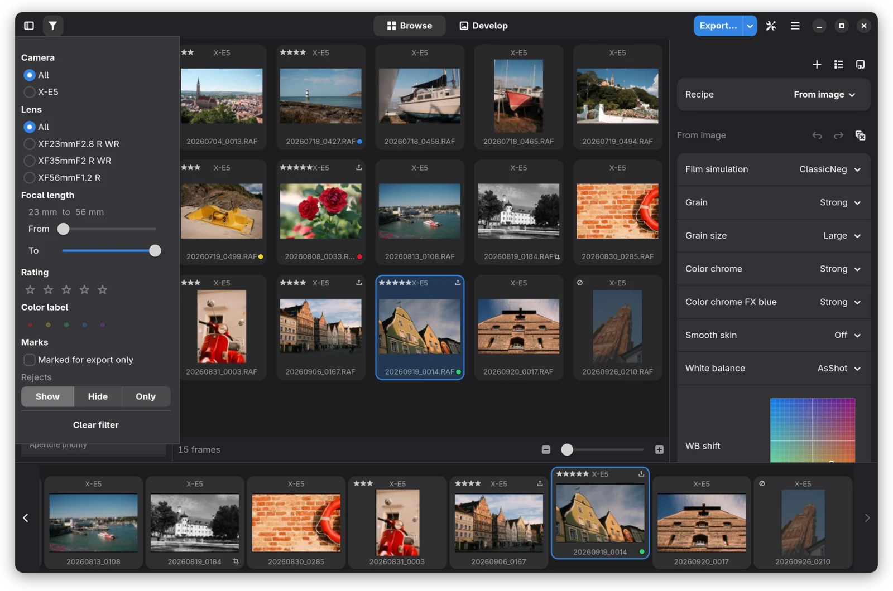

## Crop, straighten and perspective

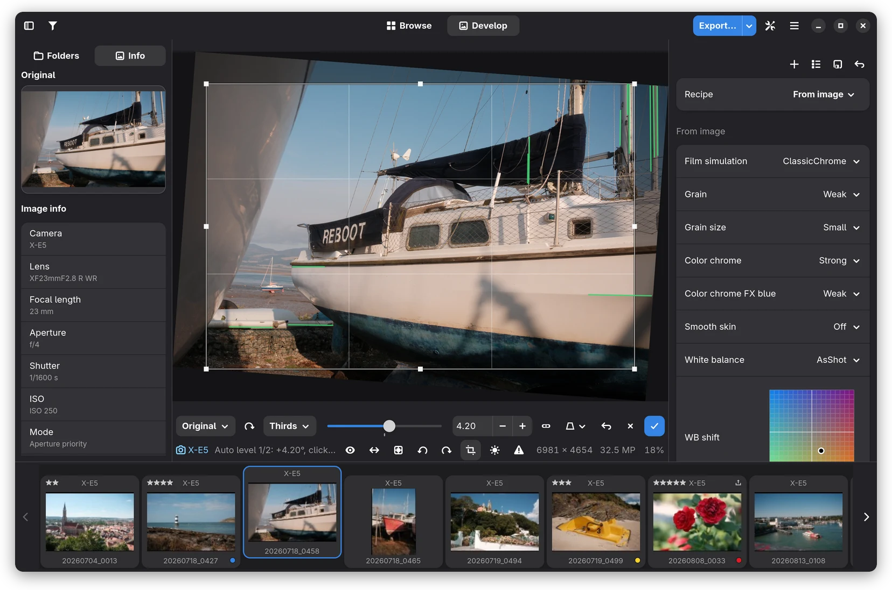

- **Crop** with fix aspect ratios and composition
  guides (`c` opens the editor, Return applies, Escape cancels).
- **Straighten** with a slider, by drawing a horizon with the right
  mouse button, or with **Auto level**, which finds the strongest lines
  and offers up to three candidates (click again for the next one).
- **Rotate** in 90° steps.

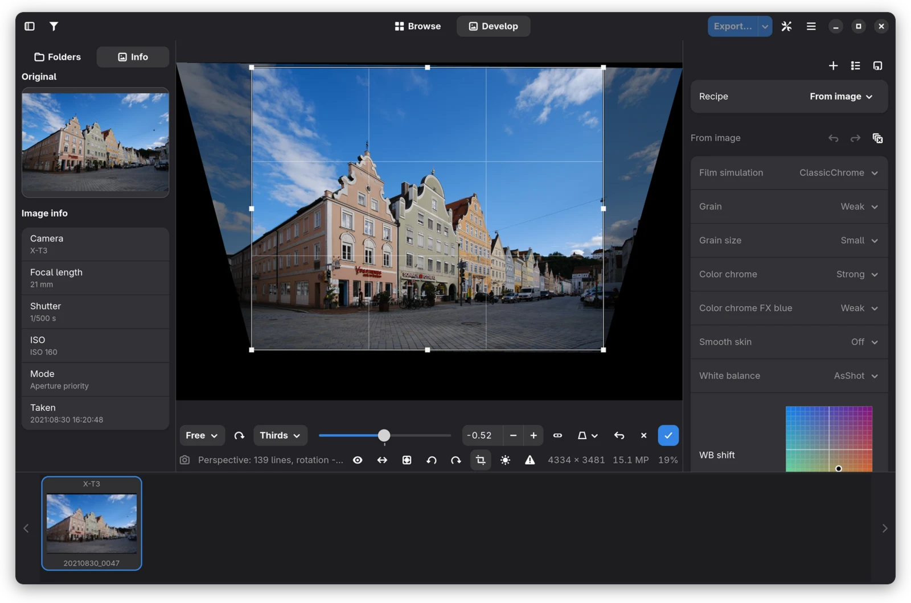

**Perspective** correction straightens converging vertical or
horizontal lines, or both. Crop, angle and perspective are kept per
image beside the RAF and apply to the preview and every export.

## Export

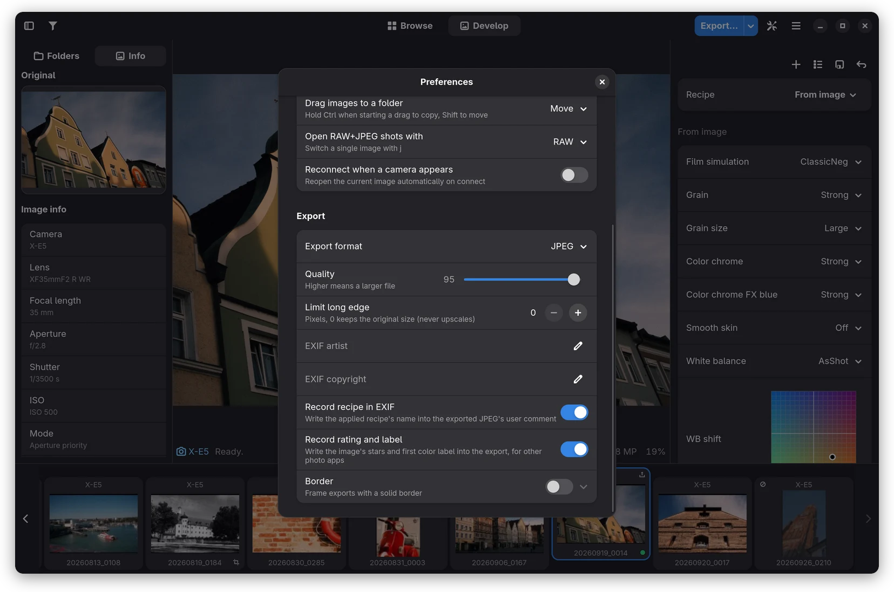

- **One image** (`Ctrl+E`) or **a batch**: everything marked for
  export or everything shown, over one camera connection. An
  interrupted batch resumes where it stopped.
- **Formats** as far as the body supports them: JPEG, HEIF (10 bit),
  TIFF in 8 or 16 bit, and JPEG XL from the camera JPEG or in 8 or 16
  bit.
- **Options**: quality, a long edge limit, a framing border that can
  also pad to an aspect ratio, artist and copyright, the recipe's name
  and the image's rating and label in the metadata.

## Keyboard

`Ctrl+?` shows every shortcut. The ones used most: `Left`/`Right` (hold
to glide through the folder), `g` grid, `c` crop, `h` histogram, `\`
peek at the original, `Alt+1` to `Alt+5` stars, `x` reject, `e` mark for
export, `1` to `9` recipe hotkeys, `Ctrl+Z` undo an edit, `Ctrl+S` save
the recipe, `Ctrl+E` export.
